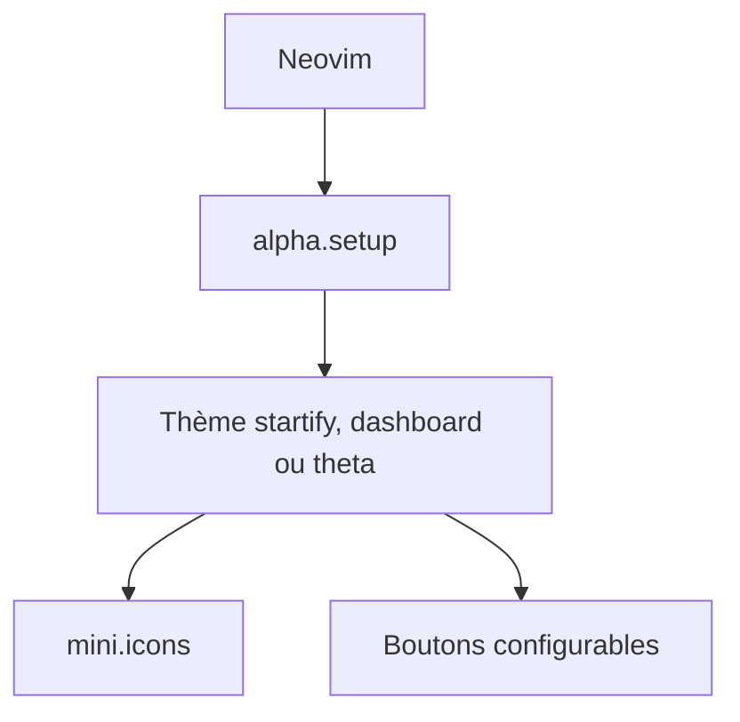

# goolord/alpha-nvim

> Programmable start screen for Neovim, with themes described as data.

## The problem
Neovim opens on an empty buffer, with no quick access to recent files or frequent actions.

## What it actually does
A Lua plugin that displays a start screen and also serves as a small UI library. Three bundled themes: startify, dashboard and theta. Themes are plain data tables. File icons come from mini.icons or nvim-web-devicons.

## How it is wired
Simplified diagram based on the sheet, no diagram provided.



## Trying it
```lua
{
    'goolord/alpha-nvim',
    dependencies = { 'nvim-mini/mini.icons' },
    config = function ()
        require'alpha'.setup(require'alpha.themes.startify'.config)
    end
};
```

## Cost and gotchas
Free. A plugin manager is needed (lazy.nvim, packer or paq). The theta theme also requires plenary.nvim.

## What it is not
Not a session manager: the README points to Shatur/neovim-session-manager. The speed measurements cover only configuration, not rendering.

## Alternatives
- Shatur/neovim-session-manager: for managing sessions, which alpha does not do.

## For you
Ignore: editor comfort with no effect on your data / AI work, take it only if you already use Neovim.
