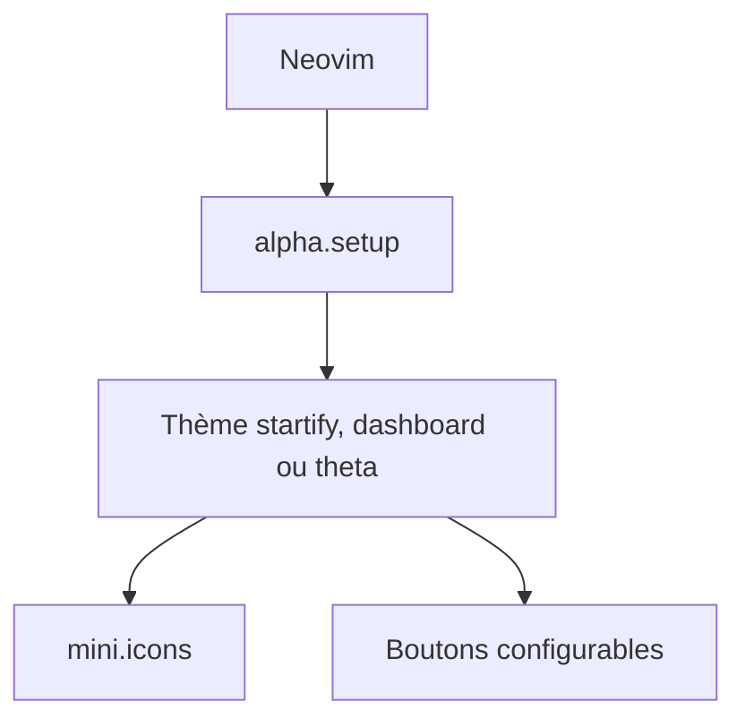

# goolord/alpha-nvim

> Écran d'accueil programmable pour Neovim, avec des thèmes décrits comme des données.

## Le problème
Neovim s'ouvre sur un tampon vide, sans accès rapide aux fichiers récents ni aux actions fréquentes.

## Ce que ça fait vraiment
Une extension Lua qui affiche un écran d'accueil et sert aussi de petite bibliothèque d'interface. Trois thèmes fournis : startify, dashboard et theta. Les thèmes sont de simples tables de données. Les icônes de fichiers passent par mini.icons ou nvim-web-devicons.

## Comment c'est branché
Schéma simplifié d'après la fiche, sans diagramme fourni.



## Essayer
```lua
{
    'goolord/alpha-nvim',
    dependencies = { 'nvim-mini/mini.icons' },
    config = function ()
        require'alpha'.setup(require'alpha.themes.startify'.config)
    end
};
```

## Coût et pièges
Gratuit. Il faut un gestionnaire d'extensions (lazy.nvim, packer ou paq). Le thème theta demande aussi plenary.nvim.

## Ce que ce n'est pas
Pas un gestionnaire de sessions : le README renvoie vers Shatur/neovim-session-manager. Les mesures de vitesse ne couvrent que la configuration, pas l'affichage.

## Alternatives
- Shatur/neovim-session-manager : pour gérer les sessions, que alpha ne fait pas.

## Pour toi
À ignorer : confort d'éditeur sans effet sur ton travail data / IA, à prendre seulement si tu es déjà sous Neovim.

