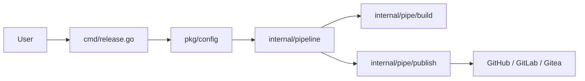

# goreleaser/goreleaser

> Command-line tool that automates publishing software releases, mostly Go.

## The problem
Publishing a release (cross-platform binaries, archives, signatures, package repositories) requires fragile scripts.

## What it actually does
The README is very short: it details nothing. From the code, a CLI reads a YAML file and chains "pipes" (build, archive, checksums, changelog, signing, publishing, announcement). Builders exist for Go, Rust, Zig, Deno, Poetry, and clients for GitHub, GitLab, Gitea. Subcommands: `build`, `check`, `release`, `publish`, `announce`, `healthcheck`, `init`, `mcp`.

## How it is wired

## Trying it
No command in the README: the documentation is at goreleaser.com.

## Cost and gotchas
Publishes to third-party services: GitHub or GitLab tokens and registries must be prepared. All the documentation lives outside the repository.

## What it is not
Not a continuous integration tool: it plugs into one. The README says nothing about installation or options.

## Alternatives
No named alternative (nearly empty README).

## For you
Worth watching: useful if you distribute Go tools as binaries; too little material to say more, outside your Python needs.
