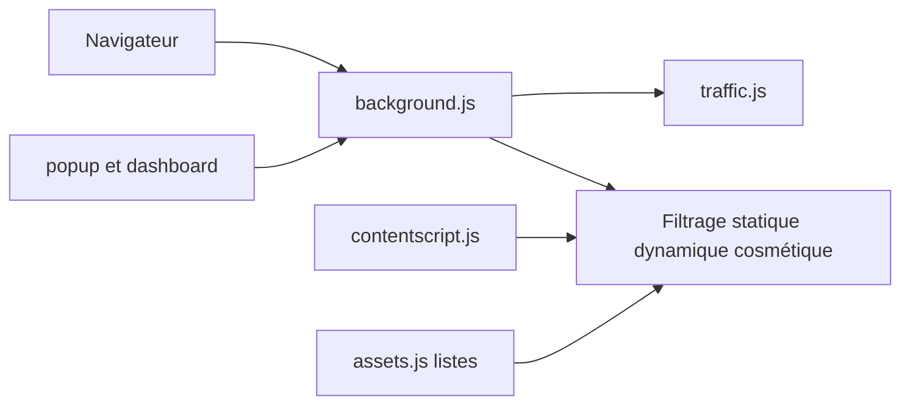

# gorhill/uBlock

> Blocker of ads, trackers and malicious sites for Firefox and Chromium, light on CPU and memory.

## The problem
Web pages embed ads, trackers and intrusive scripts that slow browsing down and expose privacy.

## What it actually does
uBlock Origin applies filter lists (EasyList, EasyPrivacy, malware lists, extended syntax) through static, dynamic, cosmetic and scriptlet engines, with an advanced per-site firewall mode. An MV3 version has its own rulesets. The README states that blocking is not theft and that distribution is evolving.

## How it is wired

## Trying it
No documented command: install from the Firefox or Edge add-ons, or from the GitHub releases page (manual installation).

## Cost and gotchas
Free, no donations requested. The Chrome Web Store removed the extension on 2026-08-31: on Chromium, manual installation with no automatic updates. Do not combine with another blocker.

## What it is not
Not an enterprise security tool; the README says it works best on Firefox. GPL-3.0 license (copyleft), with no effect for personal use.

## Alternatives
No alternative named in the README (comparison with Adblock Plus for the default lists).

## For you
Adopt: reduces trackers and needless loads during your research, preferably installed on Firefox.
