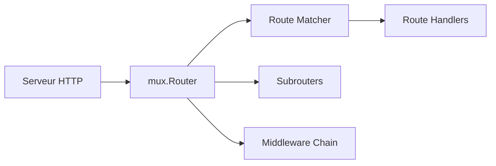

# gorilla/mux

> HTTP router for Go compatible with `http.Handler`, for anyone writing APIs and web services in Go.

## The problem
Go's standard multiplexer routes poorly by host, method, URL variables or regular expression.

## What it actually does
`mux.Router` compares each request against registered routes in order: path, prefix, host, scheme, headers, query values, methods or a custom matcher. Variables (`{id:[0-9]+}`) are read via `mux.Vars()`. Named routes can be "reversed" into URLs, subrouters group common conditions, `Use()` adds middlewares and `CORSMethodMiddleware` sets the allowed-methods header.

## How it is wired


## Trying it
```bash
go get -u github.com/gorilla/mux
```
The README follows with Go examples (`mux.NewRouter()`, `r.HandleFunc(...)`) not reproduced here.

## Cost and gotchas
Free, no declared external dependency. Last push on 2024-08-15, more than a year ago: verify before a new project. It does not handle the other CORS headers.

## What it is not
Not a full web framework: no validation, no ORM, no templates.

## Alternatives
No alternative cited in the README (only `http.ServeMux` serves as a reference).

## For you
Watch: relevant only if you serve models behind a Go API; the recent inactivity calls for comparing before depending on it.
