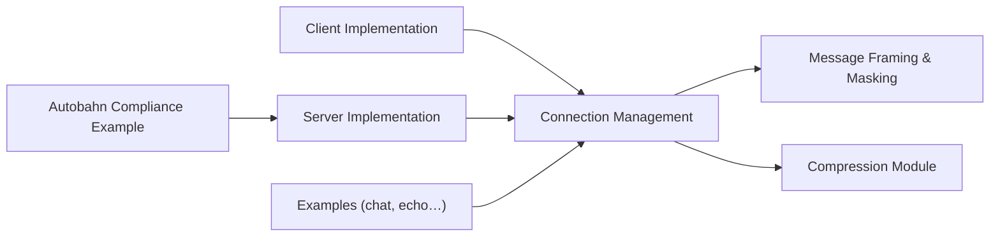

# gorilla/websocket

> Go implementation of the WebSocket protocol, for anyone writing Go servers or clients.

## The problem
Go's standard library does not provide a complete WebSocket implementation.

## What it actually does
Provides an implementation of the protocol (client, server, compression, masking, prepared messages). The README claims a stable API and passing the Autobahn Test Suite server tests. The repository offers examples: chat, command, echo, file watching, client/server.

## How it is wired


## Trying it
```bash
go get github.com/gorilla/websocket
```

## Cost and gotchas
Free. Last push on 2025-03-19, more than a year ago: check the state of issue tracking (82 open) before making it a dependency.

## What it is not
Not a messaging framework: no rooms, no reconnection, no persistence. It covers only the protocol.

## Alternatives
No alternative named in the README.

## For you
Watch: only useful if you expose a Go service over WebSocket (inference streaming, for example); recent activity is low.
