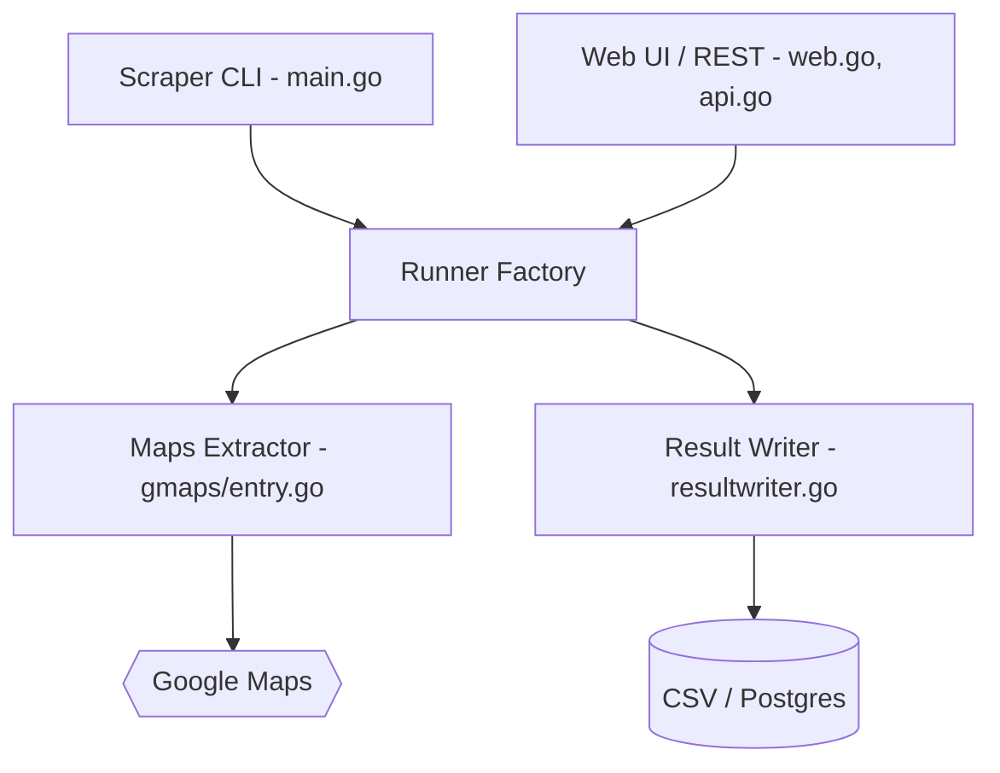

# gosom/google-maps-scraper

> Google Maps listing extractor (contacts, reviews, coordinates) via CLI, web interface or REST API.

## The problem
Building a list of local businesses with phone, website and e-mail from Google Maps is done by hand or through paid APIs.

## What it actually does
Browses Google Maps with Playwright and extracts 36 fields (title, address, reviews, coordinates…). The `-email` option crawls the businesses' websites. Outputs: CSV, JSON, PostgreSQL, S3 or LeadsDB. Modes: web UI, REST, geographic grid, resume, shared database for multi-machine runs. A skill for coding agents drives the whole thing.

## How it is wired


## Trying it
```bash
docker run -v gmaps-playwright-cache:/opt \
  -v "$PWD/example-queries.txt:/queries.txt:ro" \
  -v "$PWD/gmaps-output:/out" \
  gosom/google-maps-scraper \
  -input /queries.txt -results /out/results.csv -depth 1 -exit-on-inactivity 3m
```

## Cost and gotchas
Large volumes require paid proxies (sponsors are listed, with affiliate links). About 120 places per minute, browsers hungry for CPU and RAM. Anonymous statistics are sent, which can be disabled via `DISABLE_TELEMETRY=1`.

## What it is not
Not an official API: the README reminds that scraping may violate the terms of service. The fast mode is in beta and may be blocked.

## Alternatives
- SerpApi: paid Google Maps data API, with no browser or proxies to manage.
- Scrap.io: country-scale exports, no infrastructure.

## For you
Worth watching for local data collection, but the legal risk and blocking by Google must be assessed before any use.
