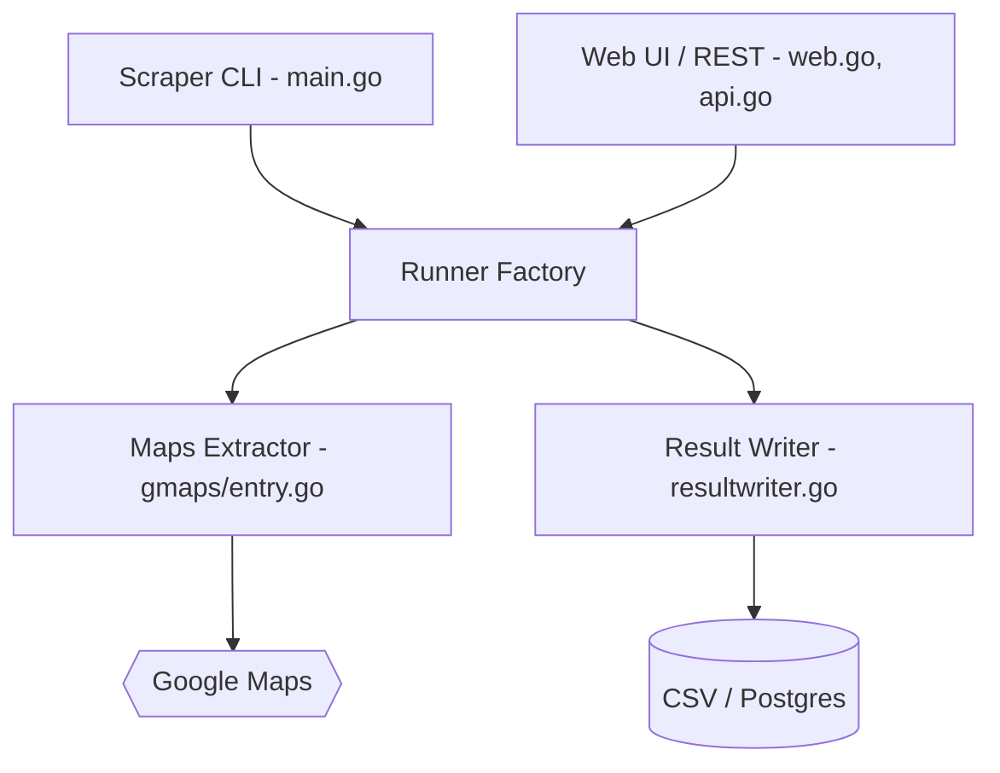

# gosom/google-maps-scraper

> Extracteur de fiches Google Maps (contacts, avis, coordonnées) en CLI, interface web ou API REST.

## Le problème
Constituer une liste d'entreprises locales avec téléphone, site et e-mail à partir de Google Maps se fait à la main ou via des API payantes.

## Ce que ça fait vraiment
Navigue sur Google Maps avec Playwright et extrait 36 champs (titre, adresse, avis, coordonnées…). Option `-email` pour crawler les sites des entreprises. Sorties CSV, JSON, PostgreSQL, S3 ou LeadsDB. Modes : web UI, REST, grille géographique, reprise, base partagée pour du multi-machines. Un skill pour agents de code pilote le tout.

## Comment c'est branché


## Essayer
```bash
docker run -v gmaps-playwright-cache:/opt \
  -v "$PWD/example-queries.txt:/queries.txt:ro" \
  -v "$PWD/gmaps-output:/out" \
  gosom/google-maps-scraper \
  -input /queries.txt -results /out/results.csv -depth 1 -exit-on-inactivity 3m
```

## Coût et pièges
Les gros volumes demandent des proxys payants (des sponsors sont listés, avec liens d'affiliation). Environ 120 lieux par minute, navigateurs gourmands en CPU et RAM. Statistiques anonymes envoyées, désactivables via `DISABLE_TELEMETRY=1`.

## Ce que ce n'est pas
Pas une API officielle : le README rappelle que le scraping peut violer les conditions d'utilisation. Le mode rapide est en bêta et peut être bloqué.

## Alternatives
- SerpApi : API payante de données Google Maps, sans gérer navigateur ni proxys.
- Scrap.io : exports à l'échelle d'un pays, sans infrastructure.

## Pour toi
À surveiller pour de la collecte de données locales, mais le risque juridique et le blocage par Google doivent être évalués avant tout usage.

