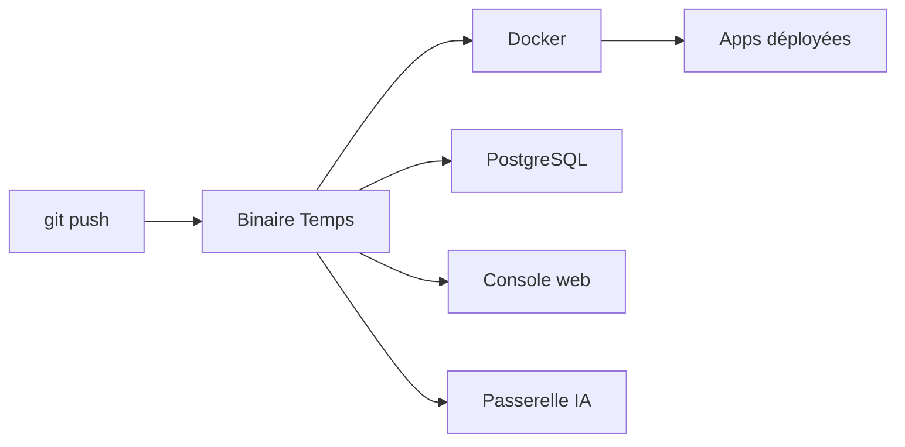

# gotempsh/temps

> Self-hosted single-binary platform to deploy applications and observe their errors, traces, logs and AI costs.

## The problem
Deploying applications and then assembling databases, analytics, error tracking, logs and an LLM gateway alongside forces you to manage many separate services.

## What it actually does
A script installs Temps on an Ubuntu server: deployment by git push, managed databases (PostgreSQL, Redis, MongoDB, MariaDB), analytics, Sentry-compatible errors, OpenTelemetry traces, logs, uptime, e-mail. On top of that come Docker or Firecracker sandboxes and an OpenAI-compatible gateway with cost per model. Import from Coolify, Dokploy, Vercel and others.

## How it is wired
Simplified diagram based on the sheet, no diagram provided.


## Trying it
```bash
curl -fsSL https://temps.sh/deploy.sh | bash
bunx skills add gotempsh/temps --skill temps temps-platform-setup
bunx @temps-sdk/cli@0.1.38 login https://console.your-server.example
```

## Cost and gotchas
A dedicated Ubuntu 22.04 or 24.04 server is required; the script installs Docker and PostgreSQL. LLM provider keys remain at your expense. A script run as `curl | bash` deserves review.

## What it is not
Not an MLOps tool in the sense of training or a model registry. It sends anonymous usage events (can be disabled with `TEMPS_TELEMETRY=0`). A Temps Cloud offering exists if you do not want a server.

## Alternatives
- Coolify: cited among the compared and importable platforms.
- Dokploy: likewise, another self-hosted deployment platform.
- Vercel: managed service, importable via `temps migrate`.

## For you
Worth watching: the combination of deployment plus observability plus LLM gateway is useful for hosting AI services, but the project is young and broad.
