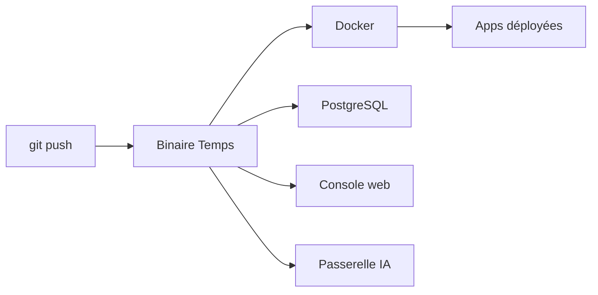

# gotempsh/temps

> Plateforme auto-hébergée en un binaire pour déployer des applications et observer leurs erreurs, traces, logs et coûts d'IA.

## Le problème
Déployer des applications puis assembler à côté bases, analytics, suivi d'erreurs, logs et passerelle LLM oblige à gérer beaucoup de services séparés.

## Ce que ça fait vraiment
Un script installe Temps sur un serveur Ubuntu : déploiement par git push, bases gérées (PostgreSQL, Redis, MongoDB, MariaDB), analytics, erreurs compatibles Sentry, traces OpenTelemetry, logs, uptime, e-mail. S'y ajoutent des sandboxes Docker ou Firecracker et une passerelle compatible OpenAI avec coût par modèle. Import depuis Coolify, Dokploy, Vercel et autres.

## Comment c'est branché
Schéma simplifié d'après la fiche, sans diagramme fourni.


## Essayer
```bash
curl -fsSL https://temps.sh/deploy.sh | bash
bunx skills add gotempsh/temps --skill temps temps-platform-setup
bunx @temps-sdk/cli@0.1.38 login https://console.your-server.example
```

## Coût et pièges
Il faut un serveur Ubuntu 22.04 ou 24.04 dédié ; le script installe Docker et PostgreSQL. Les clés des fournisseurs de LLM restent à ta charge. Un script exécuté en `curl | bash` mérite relecture.

## Ce que ce n'est pas
Pas un outil de MLOps au sens entraînement ou registre de modèles. Il envoie des événements d'usage anonymes (désactivables avec `TEMPS_TELEMETRY=0`). Une offre Temps Cloud existe si tu ne veux pas de serveur.

## Alternatives
- Coolify : cité parmi les plateformes comparées et importables.
- Dokploy : idem, autre plateforme de déploiement auto-hébergée.
- Vercel : service géré, importable via `temps migrate`.

## Pour toi
À surveiller : l'ensemble déploiement plus observabilité plus passerelle LLM est utile pour héberger des services d'IA, mais le projet est jeune et large.

