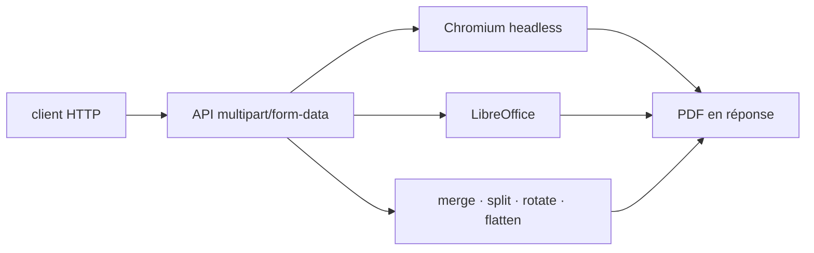

# gotenberg/gotenberg

> Docker API for converting documents to PDF, driven by multipart/form-data requests.

## The problem
Converting HTML or office documents to PDF forces you to install and maintain Chromium, LibreOffice
and fonts on every machine that needs them.

## What it actually does
A container exposes an API: you send your files as `multipart/form-data`, you get a PDF back. It
converts HTML, URLs and Markdown through headless Chromium, and office documents (over 100 formats)
through LibreOffice. It merges, splits, rotates and flattens PDFs, applies watermarks, stamps and
encryption, produces PDF/A and PDF/UA, captures screenshots of URLs and HTML, and reads or writes
metadata and bookmarks.

## How it is wired


## Trying it
```bash
docker run --rm -p 3000:3000 gotenberg/gotenberg:8
curl \
  --request POST http://localhost:3000/forms/chromium/convert/url \
  --form url=https://sparksuite.github.io/simple-html-invoice-template/ \
  -o invoice.pdf
```

## Cost and gotchas
Free. You need Docker and memory: the container bundles Chromium and LibreOffice. The README is very
short and points all fine-grained configuration to the external documentation.

## What it is not
It is not a library to import: it is an HTTP service, hence a network dependency and one more
container to operate. It is not an interactive PDF editor nor a text extraction engine: it produces
and manipulates, it does not read the content.

## Alternatives
No alternative is named in the README.

## For you
The simplest way to turn a generated HTML report into a PDF from a pipeline, without installing
Chromium in your job's image.
