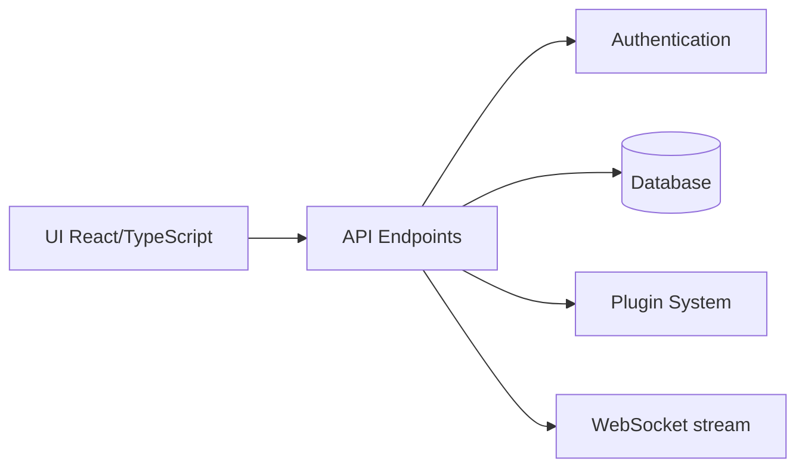

# gotify/server

> Self-hosted notification server: sending through a REST API, real-time reception through WebSocket.

## The problem
Existing notification services are either commercial or abandoned; the author wanted a simple server to host oneself.

## What it actually does
Message sending via REST, reception via WebSocket, management of users, clients and applications, plugins, web interface (`./ui`), CLI (`gotify/cli`) and Android application (`gotify/android`). Based on the code: Go backend (api, auth, database, plugin, router) and React/TypeScript interface.

## How it is wired

## Trying it
No command in the README: links to the installation and configuration pages.

## Cost and gotchas
License present but not identified by GitHub: to be checked. The README is short, installation is in the external documentation.

## What it is not
It is not a hosted push service. The README specifies neither the installation nor the limits.

## Alternatives
No alternative named in the README.

## For you
Worth watching: a good candidate for receiving the alerts from your ML jobs, provided the license is confirmed.
