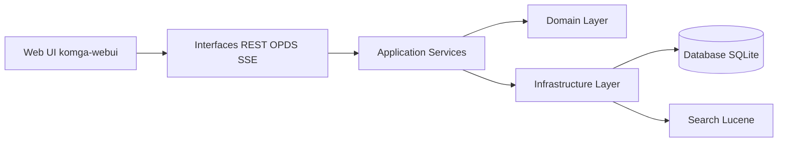

# gotson/komga

> Self-hosted server for comic, manga and e-book libraries, with a web reader.

## The problem
A collection of comics and eBooks scattered across files is tedious to browse, to read on several devices and to keep in sync.

## What it actually does
Responsive web interface, collections and reading lists, metadata editing and import, web reader, user management with per-library permissions, REST API, OPDS v1 and v2 feeds, Kobo and KOReader sync, duplicate detection. Based on the code: layered Kotlin backend, SQLite database with Flyway migrations, Lucene search, Vue frontend.

## How it is wired

## Trying it
The README gives no command and points to the website for installation. Nothing to copy here.

## Cost and gotchas
Free, MIT. Installation is described outside the README. The repository targets comic and eBook files that you must own legally.

## What it is not
Not a data or AI tool. The detail of the role of "Komga Tray" (desktop application) is inferred from the code, not from the README. The "External OPDS Endpoints" in the diagram describe the feeds it exposes.

## Alternatives
No alternative named in the README.

## For you
Ignore for your line of work: a good personal reading server, but unrelated to data, AI or MLOps.
