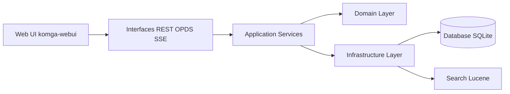

# gotson/komga

> Serveur auto-hébergé pour bibliothèques de bandes dessinées, mangas et livres numériques, avec lecteur web.

## Le problème
Une collection de BD et d'eBooks éparpillée en fichiers est pénible à parcourir, à lire sur plusieurs appareils et à synchroniser.

## Ce que ça fait vraiment
Interface web adaptative, collections et listes de lecture, édition et import de métadonnées, lecteur web, gestion d'utilisateurs avec droits par bibliothèque, API REST, flux OPDS v1 et v2, synchronisation Kobo et KOReader, détection de doublons. D'après le code : backend Kotlin en couches, base SQLite avec migrations Flyway, recherche Lucene, frontend Vue.

## Comment c'est branché

## Essayer
Le README ne donne pas de commande et renvoie au site pour l'installation. Rien à recopier ici.

## Coût et pièges
Gratuit, MIT. Installation décrite hors du README. Le dépôt vise des fichiers de BD et d'eBooks que tu dois posséder légalement.

## Ce que ce n'est pas
Pas un outil data ou IA. Le détail du rôle de « Komga Tray » (application de bureau) est déduit du code, pas du README. Les « External OPDS Endpoints » du schéma décrivent les flux exposés.

## Alternatives
Aucune alternative nommée dans le README.

## Pour toi
À ignorer pour ton métier : bon serveur de lecture personnelle, mais sans lien avec data, IA ou MLOps.

