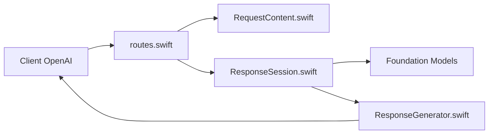

# gouwsxander/Apple-Intelligence-API

> Swift server exposing Apple Intelligence's on-device models through an OpenAI-compatible API.

## The problem
Apple's Foundation Models can only be used from native Swift code, not from OpenAI clients.

## What it actually does
Vapor server: `/api/v1/chat/completions` (single request or conversation), SSE streaming, structured JSON outputs, list of `base` and `permissive` models. Everything runs on the device, with no API key. No authentication, tool calling or tests.

## How it is wired


## Trying it
```bash
swift build
swift run AppleIntelligenceApi serve
curl http://localhost:8080/api/v1/chat/completions -H "Content-Type: application/json" -d '{"model":"base","messages":[{"role":"user","content":"What is the capital of France?"}]}'
```

## Cost and gotchas
Free, but requires an Apple Intelligence device and Swift 6.0+. No authentication: do not expose it on the network.

## What it is not
Not a cloud service nor a powerful model; unofficial, unrelated to Apple. Incomplete features, no tests. Last push January 2026.

## Alternatives
No alternative cited in the README.

## For you
Worth watching: handy for testing Apple's local model from your OpenAI tools, but it remains a prototype with no authentication.
