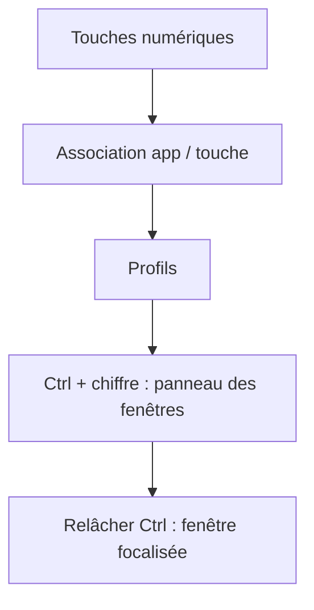

# gouwsxander/Reef

> macOS window manager that gives each application its own Alt-Tab, for Mac users.

## The problem
On macOS, switching between windows of the same application means hunting for them with the keyboard or mouse.

## What it actually does
You assign applications to number keys, then Ctrl + digit opens a panel listing that application's windows. Profiles group sets of assignments (for example "Coding" and "Browsing"). Switching stays limited to the current macOS Space.

## How it is wired
Simplified diagram based on the sheet, no diagram provided.



## Trying it
```bash
# Aucune commande documentée : télécharger le .zip, le décompresser,
# puis glisser Reef.app dans le dossier Applications.
```

## Cost and gotchas
Free or pay-what-you-want. Requires macOS 14.6 (Sonoma) or later; pull requests are not guaranteed to be handled.

## What it is not
Not a window placement manager: Rectangle positions windows, Reef refocuses them. No Linux or Windows version.

## Alternatives
- Rectangle: to organize and tidy windows, complementary.
- AltTab for macOS: for a classic window switcher.
- yabai and Aerospace: for full tiling.

## For you
Ignore: a macOS convenience tool unrelated to data / AI / MLOps work, and unusable under WSL or Linux.
