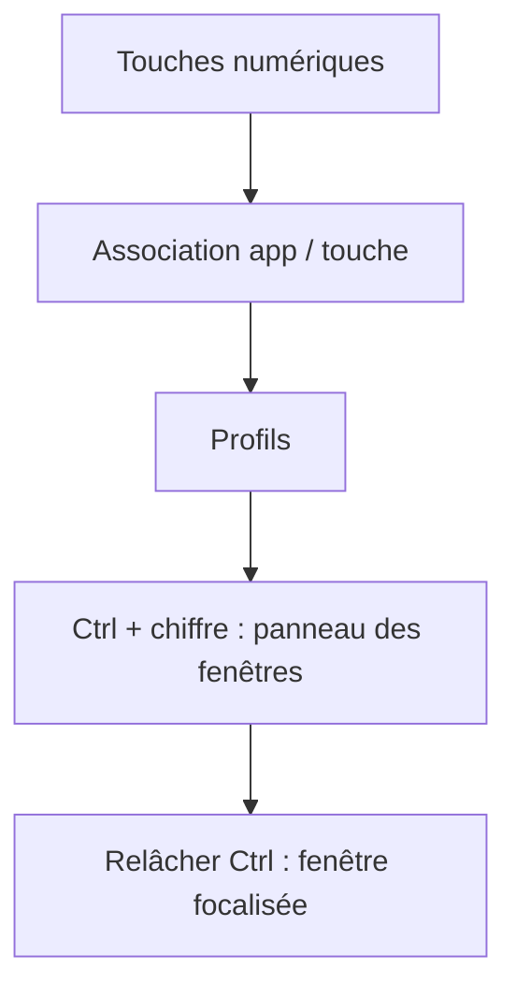

# gouwsxander/Reef

> Gestionnaire de fenêtres macOS qui donne à chaque application son propre Alt-Tab, pour utilisateurs de Mac.

## Le problème
Sur macOS, passer d'une fenêtre à l'autre d'une même application oblige à chercher au clavier ou à la souris.

## Ce que ça fait vraiment
On associe des applications aux touches numériques, puis Ctrl + chiffre ouvre un panneau listant les fenêtres de cette application. Des profils regroupent des jeux d'associations (par exemple « Coding » et « Browsing »). Le changement reste limité à l'espace (Space) macOS courant.

## Comment c'est branché
Schéma simplifié d'après la fiche, sans diagramme fourni.



## Essayer
```bash
# Aucune commande documentée : télécharger le .zip, le décompresser,
# puis glisser Reef.app dans le dossier Applications.
```

## Coût et pièges
Gratuit ou prix libre. Exige macOS 14.6 (Sonoma) ou plus récent ; les pull requests ne sont pas garanties d'être traitées.

## Ce que ce n'est pas
Pas un gestionnaire de placement de fenêtres : Rectangle positionne, Reef refocalise. Aucune version Linux ni Windows.

## Alternatives
- Rectangle : pour organiser et ranger les fenêtres, complémentaire.
- AltTab for macOS : pour un sélecteur de fenêtres classique.
- yabai et Aerospace : pour un tiling complet.

## Pour toi
Ignorer : outil macOS de confort sans lien avec un travail data / IA / MLOps, et inutilisable sous WSL ou Linux.

