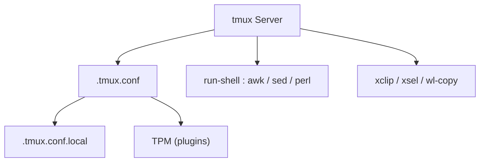

# gpakosz/.tmux

> Self-contained tmux configuration, with a Powerline theme and ready-to-use key bindings.

## The problem
Default tmux takes hours of tuning to get a readable status bar and comfortable key bindings.

## What it actually does
A `.tmux.conf` file you should not edit, plus a `.tmux.conf.local` for your own settings. It adds the secondary prefix `C-a`, a status bar (battery, load, uptime, SSH hostname), copy to the clipboard, Vim-style key bindings, TPM plugin management, and the ability to maximize a pane into a new window.

## How it is wired


## Trying it
```bash
curl -fsSL "https://github.com/gpakosz/.tmux/raw/refs/heads/master/install.sh#$(date +%s)" | bash
tmux -f /dev/null -L test
```

## Cost and gotchas
Free. Requires tmux 2.6 or later, awk, perl, grep and sed. Installing through `curl | bash` runs a remote script: read it first. Under Cygwin, the configuration uses a lot of CPU.

## What it is not
Not a tmux plugin but a complete configuration. Editing the main file is discouraged ("you're on your own"). Powerline symbols require a suitable font.

## Alternatives
No alternative named in the README, apart from TPM for plugins.

## For you
Adopt: if you often work on remote servers over SSH, this is a comfortable tmux base, installed with a single command.
