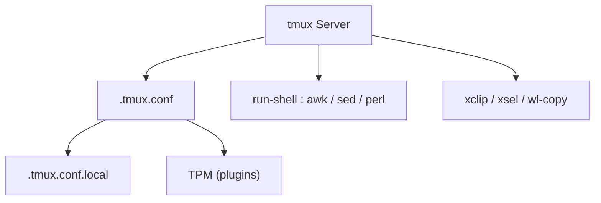

# gpakosz/.tmux

> Configuration tmux autonome, avec thème Powerline et raccourcis prêts à l'emploi.

## Le problème
Le tmux par défaut demande des heures de réglage pour obtenir une barre d'état lisible et des raccourcis confortables.

## Ce que ça fait vraiment
Un fichier `.tmux.conf` à ne pas modifier, plus un `.tmux.conf.local` pour tes réglages. Ajoute le préfixe secondaire `C-a`, une barre d'état (batterie, charge, durée de fonctionnement, nom d'hôte SSH), la copie vers le presse-papiers, des raccourcis à la Vim, la gestion des plugins TPM, et l'agrandissement d'un panneau dans une nouvelle fenêtre.

## Comment c'est branché


## Essayer
```bash
curl -fsSL "https://github.com/gpakosz/.tmux/raw/refs/heads/master/install.sh#$(date +%s)" | bash
tmux -f /dev/null -L test
```

## Coût et pièges
Gratuit. Demande tmux 2.6 ou plus, awk, perl, grep et sed. L'installation par `curl | bash` exécute un script distant : lis-le d'abord. Sous Cygwin, la configuration consomme beaucoup de processeur.

## Ce que ce n'est pas
Pas un plugin tmux mais une configuration complète. Modifier le fichier principal est déconseillé (« you're on your own »). Les symboles Powerline demandent une police adaptée.

## Alternatives
Aucune alternative nommée dans le README, hors TPM pour les plugins.

## Pour toi
À adopter : si tu travailles souvent sur des serveurs distants en SSH, c'est une base tmux confortable, installée en une commande.

