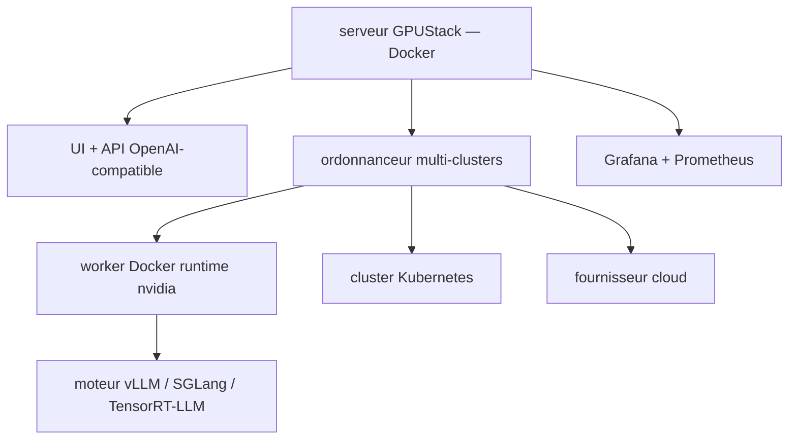

# gpustack/gpustack

> GPU cluster manager that configures inference engines and provisions instances.

## The problem
A GPU fleet spread across on-premises servers, Kubernetes and cloud has no single view, and each model requires tuning vLLM or SGLang by hand.
On the day a model is released, that tuning has to be redone.

## What it actually does
It manages several GPU clusters at once — on-premises, Kubernetes, cloud providers — and allocates GPUs through its scheduler.
It automatically configures vLLM, SGLang, TensorRT-LLM, or a custom engine, with preset low-latency or high-throughput modes, LMCache/HiCache for TTFT, and speculative decoding (EAGLE3, MTP, n-grams).
It launches on demand GPU instances reachable over SSH for development, fine-tuning or interactive workloads.
It exposes standard APIs (LLM, voice, image, video) compatible with OpenAI, with authentication, access control, token metering and Grafana/Prometheus dashboards.

## How it is wired


## Trying it
```bash
sudo docker run -d --name gpustack \
    --restart unless-stopped \
    -p 80:80 \
    --volume gpustack-data:/var/lib/gpustack \
    gpustack/gpustack
sudo docker exec gpustack cat /var/lib/gpustack/initial_admin_password
```

## Cost and gotchas
Free to install, but you need at least one NVIDIA GPU with driver, Docker and the NVIDIA Container Toolkit; workers only run on Linux (macOS excluded, Windows via WSL2 without Docker Desktop).
The worker is launched `--privileged`, `--network=host` and with the Docker socket mounted: weigh this before exposing it.

## What it is not
It is not entirely open source: the "GPU Cluster Topology" view is explicitly part of GPUStack Enterprise.
It is not an inference engine — it configures and orchestrates other people's. The announced throughput gains point to an in-house "Inference Performance Lab".

## Alternatives
- vLLM, SGLang, TensorRT-LLM: the engines themselves, if a single node is enough.

## For you
Useful as soon as the GPU fleet goes beyond one machine; first look at what moves to the Enterprise edition.
