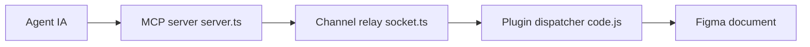

# grab/cursor-talk-to-figma-mcp

> MCP bridge letting an agent (Cursor, Claude Code) read and modify Figma designs.

## The problem
An AI agent cannot see the Figma canvas and can neither read nor modify a design.

## What it actually does
A TypeScript MCP server exposes tools (reading the selection, creating frames and text, auto-layout, styles, components, image export). It talks to a Figma plugin through a channel-based WebSocket relay (`join_channel`). It also provides guide prompts, for example bulk text replacement.

## How it is wired


## Trying it
```bash
curl -fsSL https://bun.sh/install | bash
bun setup
bun socket
```
Then install the Figma plugin and use `join_channel`.

## Cost and gotchas
Bun, Figma (account) and an MCP-compatible agent. Under WSL, uncomment `hostname: "0.0.0.0"` in `src/socket.ts`.

## What it is not
Not a design generator: it executes the actions requested by the agent. Image export is limited (base64 as text).

## Alternatives
No alternative named in the README.

## For you
Watch: a useful example of agent-tool MCP integration, but of limited data/MLOps interest unless you work with designers.
