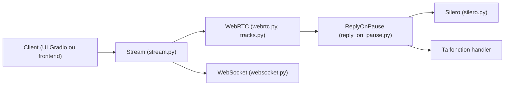

# gradio-app/fastrtc

> Python library that turns a function into a real-time audio or video stream via WebRTC or WebSocket.

## The problem
Connecting a microphone, a camera and pause detection to a model (STT, LLM, TTS) takes a lot of WebRTC plumbing.

## What it actually does
A `Stream` object wraps a Python handler: `ReplyOnPause` handles voice detection and turn-taking (Silero), and the user only codes the reply. `.ui.launch()` opens a Gradio interface, `.mount(app)` exposes WebRTC and WebSocket endpoints on FastAPI, `.fastphone()` gives a temporary phone number (Hugging Face token required). Extras `vad` and `tts`. Examples: Gemini, OpenAI Realtime, Whisper, YOLOv10, Moshi.

## How it is wired


## Trying it
```bash
pip install fastrtc
pip install "fastrtc[vad, tts]"
# stream.ui.launch()   |   stream.mount(app) avec FastAPI + uvicorn
```

## Cost and gotchas
Free; the voice chat example uses Groq, Anthropic and ElevenLabs: keys at your expense. Last push in January 2026, 82 open issues.

## What it is not
Not a voice model: only transport and turn detection. The temporary phone number is not a production service.

## Alternatives
Not documented in the README: no alternative named.

## For you
To adopt for prototyping a voice assistant or a real-time vision demo in Python: it is the building block that spares you from writing WebRTC yourself.
