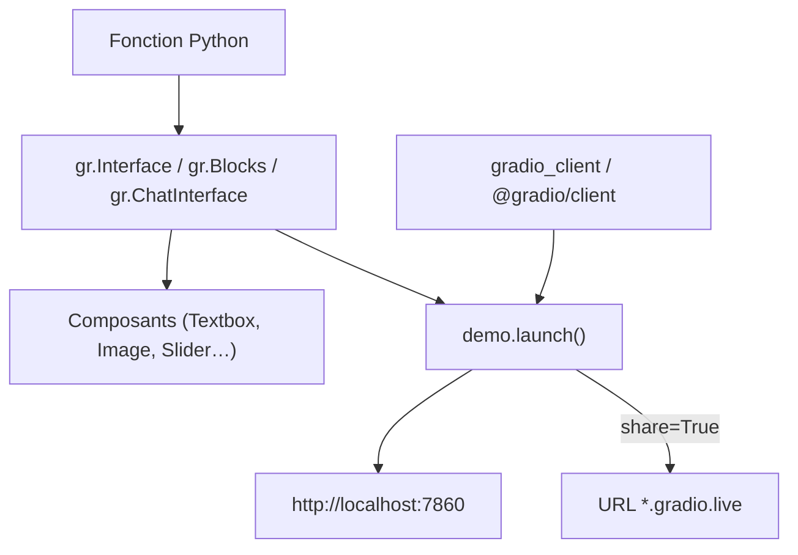

# gradio-app/gradio

> Python library that wraps a function in a shareable web demo in one line.

## The problem
Letting someone else try a model otherwise requires an interface, a server and a URL,
for a demo that should fit in ten lines.

## What it actually does
`gr.Interface` takes a function, a list of input components and a list of output components, and renders a
page. More than 30 built-in components (`gr.Textbox`, `gr.Image`, `gr.HTML`…) designed for ML.
`gr.Blocks` gives control over layout, cross data flows and conditional
visibility; `gr.ChatInterface` builds a chatbot interface from a function.
`share=True` generates a public URL in a few seconds, with the computation staying on your machine.
Python and JavaScript clients query any Gradio app programmatically.

## How it is wired


## Trying it
```bash
pip install --upgrade gradio
python app.py
gradio app.py          # rechargement à chaud
gradio --vibe app.py   # chat intégré pour éditer l'app
gradio skills add
```

## Cost and gotchas
Free, Python 3.10 minimum. `share=True` routes traffic through a `gradio.live` URL
hosted by the publisher: it is a tunnel to your machine, to be avoided for sensitive data.
Hugging Face Spaces is the hosting mode promoted, hence one more third party.

## What it is not
It is not a production deployment service: `launch()` serves a demo, not a real load.
It is not a front-end framework: customization stays within the limits of the components.
The `--vibe` mode has a model write the app, which requires a key and a review.

## Alternatives
No alternative named in the README.

## For you
The demo tool when the thing to show is a model with typed inputs, not a dashboard.
