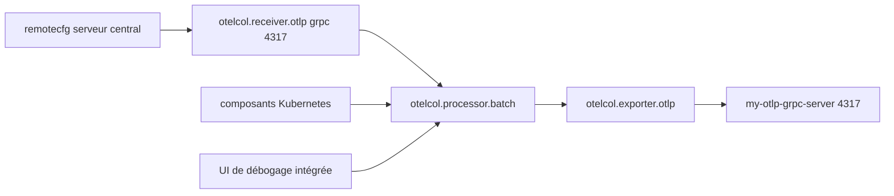

# grafana/alloy

> Open distribution of the OpenTelemetry collector, with built-in Prometheus pipelines.

## The problem
Metrics, logs, traces and profiles go through different collectors, configured separately.
Assembling them into a coherent chain takes homegrown glue.

## What it actually does
An expression-based syntax to describe programmable observability pipelines.
A distribution of the OpenTelemetry Collector that supports dozens of components, plus its own.
Integrates with OpenTelemetry Collector, Prometheus, Grafana Loki and Grafana Pyroscope, and not only Grafana.
Native Kubernetes components, clustering to spread the load, centralized configuration through `remotecfg`.

## How it is wired


## Trying it
```alloy
otelcol.receiver.otlp "example" {
  grpc {
    endpoint = "127.0.0.1:4317"
  }
  output {
    metrics = [otelcol.processor.batch.example.input]
  }
}
```
The install command is not in the README: it points to the online instructions.

## Cost and gotchas
Free and with no dependency on Grafana Cloud, but you need a backend to receive what is collected.
Release cadence: a minor version every three weeks, patch releases every one to two weeks.

## What it is not
Not a storage or an interface: it collects and transforms, nothing more.
Not a Kubernetes operator — the components replace that role, which changes habits.
Not identical to the upstream OTel collector: it is a distribution with its own syntax.

## Alternatives
The upstream OpenTelemetry collector, of which Alloy is a distribution.

## For you
A good candidate if you want a single agent for metrics, logs and profiles; the custom syntax is the real entry cost.
