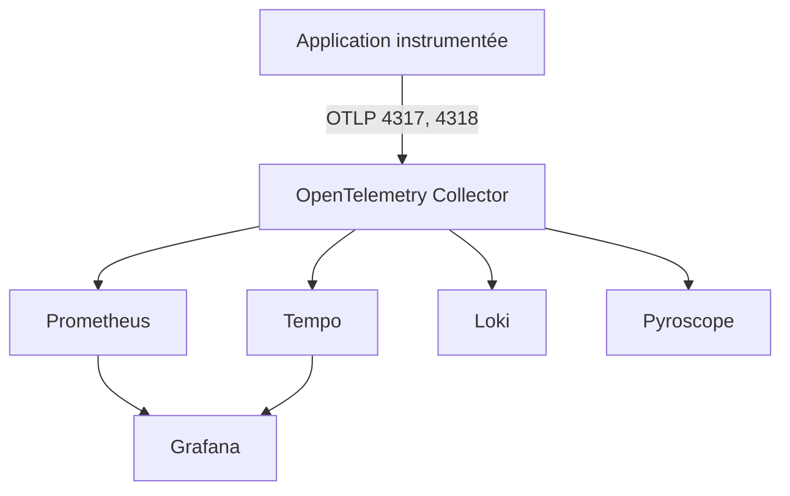

# grafana/docker-otel-lgtm

> A single Docker image with a complete OpenTelemetry backend for development, demos and testing.

## The problem
Setting up a collector, Prometheus, Tempo, Loki and Grafana to test instrumentation takes hours.

## What it actually does
One container bundles OpenTelemetry Collector, Prometheus (metrics), Tempo (traces), Loki (logs), Pyroscope (profiles) and Grafana. OBI (eBPF) is optional. Data can also be sent to another backend via OTLP.

## How it is wired
Simplified diagram based on the sheet.



## Trying it
```bash
docker pull grafana/otel-lgtm:latest
./run-lgtm.sh
./run-example.sh
./generate-traffic.sh
```

## Cost and gotchas
Free, Docker or Podman required. OBI requires Linux 5.8+ and `--privileged --pid=host`. Default credentials admin/admin.

## What it is not
Not a production solution: the README points to Grafana Cloud. Persisting `/data` does not change this usage.

## Alternatives
No alternative named in the README, apart from Grafana Cloud Application Observability for production.

## For you
Adopt it to test the telemetry of your ML services locally, in one command.
