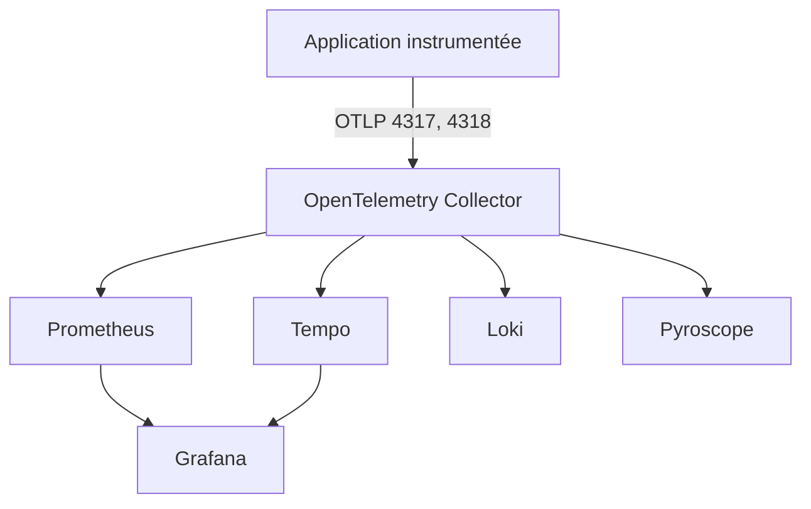

# grafana/docker-otel-lgtm

> Une image Docker unique avec backend OpenTelemetry complet pour développement, démo et tests.

## Le problème
Monter un collecteur, Prometheus, Tempo, Loki et Grafana pour tester l'instrumentation prend des heures.

## Ce que ça fait vraiment
Un conteneur embarque OpenTelemetry Collector, Prometheus (métriques), Tempo (traces), Loki (logs), Pyroscope (profils) et Grafana. OBI (eBPF) est optionnel. Les données peuvent aussi partir vers un autre backend via OTLP.

## Comment c'est branché
Schéma simplifié d'après la fiche.



## Essayer
```bash
docker pull grafana/otel-lgtm:latest
./run-lgtm.sh
./run-example.sh
./generate-traffic.sh
```

## Coût et pièges
Gratuit, Docker ou Podman requis. OBI exige Linux 5.8+ et `--privileged --pid=host`. Identifiants par défaut admin/admin.

## Ce que ce n'est pas
Pas une solution de production : le README renvoie vers Grafana Cloud. Persister `/data` ne change pas cet usage.

## Alternatives
Aucune alternative nommée dans le README, hormis Grafana Cloud Application Observability pour la production.

## Pour toi
À adopter pour tester la télémétrie de tes services ML en local, en une commande.

