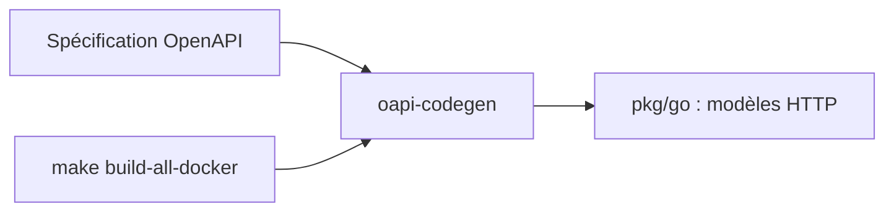

# grafana/faro

> OpenAPI specification and Go HTTP models for Grafana Faro, frontend telemetry; for SDK contributors.

## The problem
Collectors and the web SDK must share the same browser telemetry data format.

## What it actually does
Contains the Faro OpenAPI specification and generates Go HTTP models from it with oapi-codegen. The web SDK itself lives in another repository (`grafana/faro-web-sdk`). The build is done in a `faro-build` Docker image or locally.

## How it is wired
Simplified diagram based on the sheet, no diagram provided.


## Trying it
```bash
make build-all-docker
# ou en local
pip3 install yq
make install-dependencies
make build-all
```

## Cost and gotchas
Free. Docker recommended; locally, you need the Python `yq` (not mikefarah's) and oapi-codegen v2.6.0.

## What it is not
Not the monitoring SDK: go to `grafana/faro-web-sdk`. Only the Go package is documented.

## Alternatives
- grafana/faro-web-sdk: the actual web SDK for user monitoring.

## For you
Ignore: this repository only contains the API contract and Go models, the useful SDK is elsewhere.
