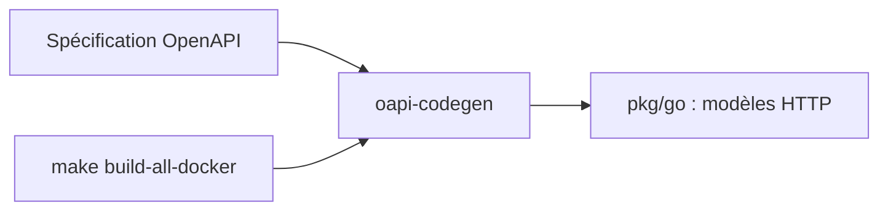

# grafana/faro

> Spécification OpenAPI et modèles HTTP Go de Grafana Faro, la télémétrie frontend ; pour contributeurs du SDK.

## Le problème
Les collecteurs et le SDK web doivent partager le même format de données de télémétrie navigateur.

## Ce que ça fait vraiment
Contient la spécification OpenAPI de Faro et génère à partir d'elle des modèles HTTP en Go avec oapi-codegen. Le SDK web, lui, vit dans un autre dépôt (`grafana/faro-web-sdk`). Le build se fait dans une image Docker `faro-build` ou en local.

## Comment c'est branché
Schéma simplifié d'après la fiche, sans diagramme fourni.


## Essayer
```bash
make build-all-docker
# ou en local
pip3 install yq
make install-dependencies
make build-all
```

## Coût et pièges
Gratuit. Docker recommandé ; en local, il faut le `yq` Python (pas celui de mikefarah) et oapi-codegen v2.6.0.

## Ce que ce n'est pas
Ce n'est pas le SDK de monitoring : il faut aller sur `grafana/faro-web-sdk`. Seul le paquet Go est documenté.

## Alternatives
- grafana/faro-web-sdk : le SDK web réel de monitoring des utilisateurs.

## Pour toi
Ignorer : ce dépôt ne contient que le contrat d'API et des modèles Go, le SDK utile est ailleurs.

