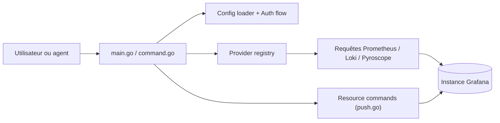

# grafana/gcx

> Grafana CLI to query metrics, logs, traces and alerts, and feed that data to a coding agent.

## The problem
Investigating production forces you to leave the editor for Grafana. A coding agent has no structured access to this data.

## What it actually does
A single command (`gcx`) to query Prometheus, Loki, Tempo, Pyroscope, list dashboards and alert rules, do GitOps (`resources pull/push`) and observability as code (Go). On Grafana Cloud it adds SLO, Synthetic Monitoring, IRM, k6 and the Assistant. A set of agent skills installs with a Claude Code plugin.

## How it is wired


## Trying it
```bash
curl -fsSL https://raw.githubusercontent.com/grafana/gcx/main/scripts/install.sh | sh
gcx login local --server http://localhost:3000 --token <token>
gcx metrics query 'rate(http_requests_total[5m])' --since 1h
gcx dashboards list
gcx resources pull dashboards -p ./resources -o yaml
```

## Cost and gotchas
The tool is free, but the Assistant is billed per token, Synthetic Monitoring per execution, k6 per user-hour and IRM per active user. Grafana 12+ is required (13 to write managed rules). `resources delete` has no confirmation.

## What it is not
It is not a Grafana server. The SLO, IRM or Assistant commands do not work on Grafana OSS. It sends usage statistics to Grafana Labs (can be disabled).

## Alternatives
The README cites Grafana's Git Sync for two-way dashboard synchronization.

## For you
Worth watching: very relevant if you use Grafana for MLOps with a coding agent; the default telemetry and the dependence on Grafana Cloud for most features need weighing.
