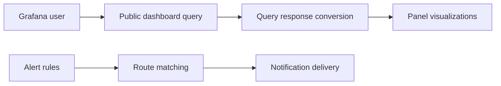

# grafana/grafana

> Observability platform for querying, visualizing, and alerting on metrics and logs.

## The problem
The metrics and logs are scattered across multiple databases. Without a common view, it is impossible to correlate them or receive alerts.

## What it actually does
Query various data sources and display them in reusable dashboards (model variables). Explore metrics and logs while preserving filters. Evaluate alerts and send notifications (Slack, PagerDuty, OpsGenie). Allows for combining multiple sources in a single graph.

## How it is wired

## Trying it
The README does not provide a command: it directs users to the installation guides and the play.grafana.org demo.

## Cost and gotchas
The data sources are your responsibility. AGPL-3.0 license: consider this if you modify and make the code available. The README does not detail paid options.

## What it is not
It's not a system for storing metrics; it connects to existing sources.

## Alternatives
No alternative is specified in the README.

## For you
To adopt: a standard for tracking pipelines, production models, and MLOps infrastructure, with an AGPL license.
