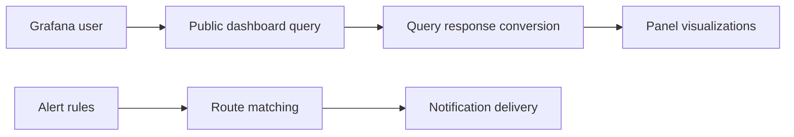

# grafana/grafana

> Plateforme d'observabilité pour interroger, visualiser et alerter sur des métriques et des logs.

## Le problème
Les métriques et logs sont dispersés dans plusieurs bases ; sans vue commune, impossible de les corréler ni d'être alerté.

## Ce que ça fait vraiment
Interroge des sources de données variées et les affiche en tableaux de bord réutilisables (variables de modèle). Explore métriques et logs en conservant les filtres. Évalue des règles d'alerte et envoie des notifications (Slack, PagerDuty, OpsGenie). Permet de mélanger plusieurs sources dans un même graphe.

## Comment c'est branché

## Essayer
Le README ne donne pas de commande : renvoie vers les guides d'installation et la démo play.grafana.org.

## Coût et pièges
Les sources de données sont à ta charge. Licence AGPL-3.0 : à considérer si tu modifies et exposes le code. Le README ne détaille pas les offres payantes.

## Ce que ce n'est pas
Pas un système de stockage de métriques : il se branche sur des sources existantes.

## Alternatives
Aucune alternative nommée dans le README.

## Pour toi
À adopter : standard pour suivre pipelines, modèles en production et infrastructure MLOps, avec une licence AGPL à connaître.

