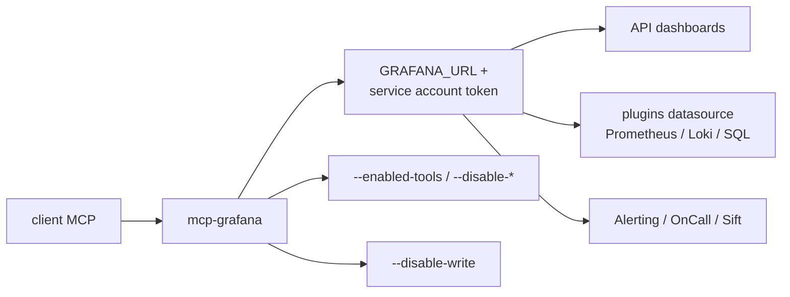

# grafana/mcp-grafana

> Official Grafana MCP server, to connect an agent to existing dashboards, metrics and logs.

## The problem
An agent has no structured access to Grafana: it guesses URLs and copies dashboard JSON.
Reading a large dashboard in full blows up the context window.

## What it actually does
Dashboard tools (search, compact summary, JSONPath extraction, partial patch), datasources,
Prometheus/Loki/unified SQL queries (ClickHouse, Snowflake, Athena, MySQL, PostgreSQL, MSSQL),
CloudWatch, Graphite, Elasticsearch, InfluxDB, Quickwit. Alerting, OnCall, incidents, Sift, annotations,
snapshots, PNG rendering, deeplinks, provisioning, and agent observability (conversations, evaluators,
test suites, offline experiments) in Grafana Cloud.

## How it is wired


## Trying it
```bash
uvx mcp-grafana
```

## Cost and gotchas
Free, but it needs a Grafana 9.0+ instance and a service account token; RBAC permissions
must be scoped tool by tool (the README suggests the `Editor` role as a coarse shortcut).
Many tool families are disabled by default. SQL datasource credentials
stay inside Grafana: the server never sees them.

## What it is not
It is not a read-only connector by default: it creates dashboards, alerts and incidents.
It is not frugal with context if you call `get_dashboard_by_uid`. PNG rendering requires
the Image Renderer service, and agent observability only works in Grafana Cloud.

## Alternatives
None named in the README.

## For you
The right entry point if your observability is already on Grafana: start with `--disable-write`.
