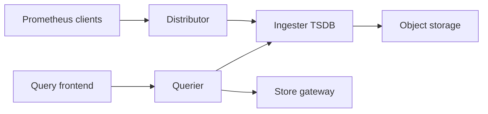

# grafana/mimir

> Scalable, multi-tenant long-term storage for Prometheus metrics, for platform teams.

## The problem
A single Prometheus cannot handle billions of series or long retention.

## What it actually does
Receives Prometheus writes, spreads and replicates them across ingesters, persists blocks in object storage (S3, GCS, Azure, Swift), and serves PromQL through the query frontend, querier and store gateway. A compactor merges blocks; a ruler evaluates rules and alerts; an Alertmanager notifies. Monolithic mode fits in a single binary. The README claims up to 1 billion active series in internal testing.

## How it is wired

## Trying it
The README gives no command; it points to the getting-started guide and the deployment guide.

## Cost and gotchas
Object storage required. AGPL-3.0 license. Around 850 open issues.

## What it is not
Not a tracing or logging tool. Not a direct replacement for Prometheus for collection.

## Alternatives
- Thanos and Cortex: the README documents migration from them.

## For you
Worth watching: relevant if you operate metrics at large scale, otherwise overkill for a data profile.
