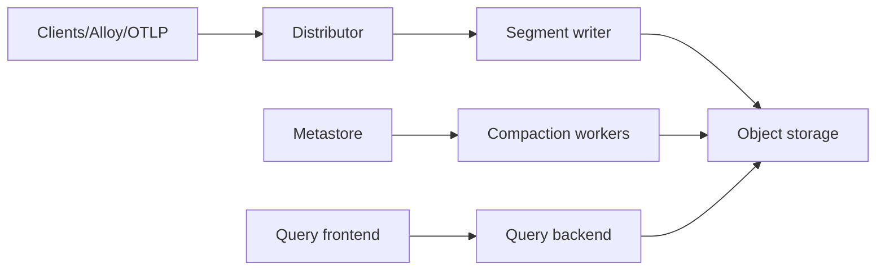

# grafana/pyroscope

> Multi-tenant continuous profiling backend (CPU, memory, I/O) visualized in Grafana.

## The problem
Finding which line of code consumes CPU or memory in production requires profiling continuously, not occasionally.

## What it actually does
Receives pprof/Pyroscope or OTLP profiles from SDKs (Go, Java, Python, Ruby, Node, .NET, Rust, eBPF), Grafana Alloy or OpenTelemetry.
v2: a distributor routes by service to segment writers that write directly to object storage (S3, GCS, Azure…), with no ingesters.
Raft metastore, background compaction, query frontend/backend producing flame graphs and diffs.
"Profiles Drilldown" UI in Grafana; single-binary mode or microservices via Helm.

## How it is wired


## Trying it
```bash
docker run -it -p 4040:4040 grafana/pyroscope
brew install pyroscope-io/brew/pyroscope
brew services start pyroscope
```

## Cost and gotchas
Free, AGPL-3.0: exposing a modified version as a service requires you to publish the source.
Object storage becomes the central dependency in v2.

## What it is not
Not a full APM: no traces or logs.
The main visualization assumes Grafana.

## Alternatives
No alternative named in the README (py-spy, rbspy, speedscope are credited as building blocks).

## For you
Worth watching for profiling Python inference services in production: relevant as soon as latency or memory becomes an issue.
