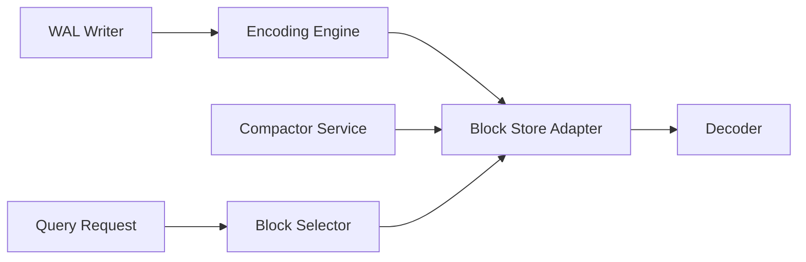

# grafana/tempo

> Large-scale distributed tracing backend that only needs object storage, for observability teams.

## The problem
Understanding the path of a request across services, without paying heavily to index traces.

## What it actually does
Ingests Jaeger, Zipkin, Kafka and OpenTelemetry traces, buffers them (WAL), encodes them into Parquet blocks and writes them to S3, GCS, Azure or local disk. The TraceQL language lets you query traces; TraceQL metrics are experimental. A compactor, a retention policy and per-tenant indexing complete the `tempodb` engine.

## How it is wired

## Trying it
The README provides no command; it points to the getting-started documentation and to Docker Compose, Helm and Jsonnet examples.

## Cost and gotchas
Object storage required. AGPL-3.0 license. The trace exploration interface is a separate Grafana component.

## What it is not
It is not a visualization tool: UI issues are handled on the Grafana side. Nor is it a metrics or logs tool (see Prometheus, Loki).

## Alternatives
- Jaeger / Zipkin: compatible formats, which Tempo can ingest.

## For you
Worth watching: useful if you instrument services or LLM pipelines with OpenTelemetry, but it is platform infrastructure, not a data tool.
