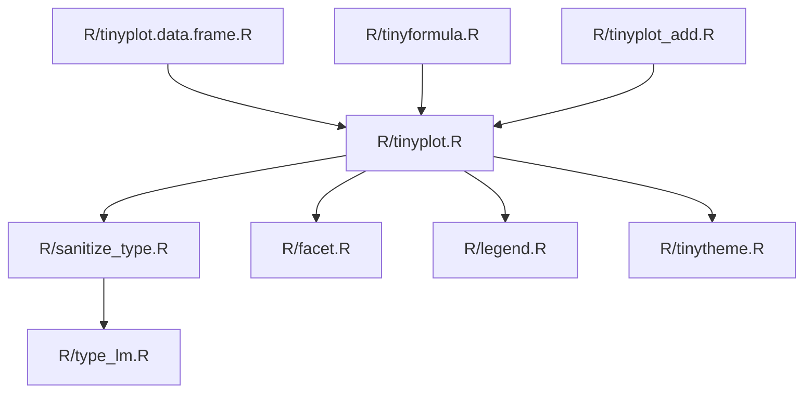

# grantmcdermott/tinyplot

> Lightweight extension of base R graphics: groups, legends, facets and themes in a single call.

## The problem
Plotting grouped data in base R requires several calls, a loop and a hand-made legend.

## What it actually does
`tinyplot()` (alias `plt()`) accepts a formula or a data frame and handles groups, legends, facets and persistent themes. It aims to replace a `plot()` call without changing the expected rendering. `plt_add()` adds layers (for example an `lm` line). It only requires base R, with no recursive dependency.

## How it is wired


## Trying it
```r
install.packages("tinyplot")
library(tinyplot)
tinyplot(Sepal.Length ~ Petal.Length | Species, data = iris)
plt_add(type = "lm")
tinytheme("clean2")
tinytheme()  # réinitialise le thème
```

## Cost and gotchas
Free, no key. R must be installed; the stable version comes from CRAN, the development version from R-universe.

## What it is not
It is not a grammar of graphics like ggplot2: it is the base R system made more convenient. The rendering is that of base graphics, not that of ggplot2.

## Alternatives
- ggplot2: a much larger ecosystem of extensions.
- lattice: another graphics system built on grid.

## For you
Worth watching if you plot in base R and want group legends without effort; not useful if you are already comfortable with ggplot2.
