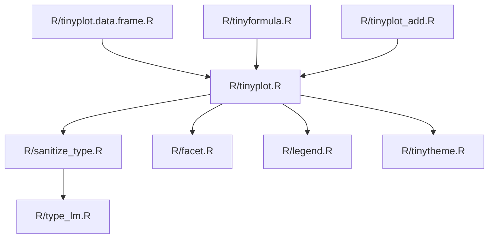

# grantmcdermott/tinyplot

> Extension légère des graphiques de base de R : groupes, légendes, facettes et thèmes en un appel.

## Le problème
Tracer des données groupées avec une légende en R de base exige plusieurs appels, une boucle et une légende faite à la main.

## Ce que ça fait vraiment
`tinyplot()` (alias `plt()`) accepte une formule ou un data frame et gère groupes, légendes, facettes et thèmes persistants. Il vise à remplacer un appel `plot()` sans changer le rendu attendu. `plt_add()` ajoute des couches (par exemple une droite `lm`). Il n'exige que R de base, sans dépendance récursive.

## Comment c'est branché


## Essayer
```r
install.packages("tinyplot")
library(tinyplot)
tinyplot(Sepal.Length ~ Petal.Length | Species, data = iris)
plt_add(type = "lm")
tinytheme("clean2")
tinytheme()  # réinitialise le thème
```

## Coût et pièges
Gratuit, aucune clé. Il faut R installé ; la version stable vient de CRAN, la version de développement de R-universe.

## Ce que ce n'est pas
Ce n'est pas une grammaire des graphiques comme ggplot2 : c'est le système de base de R rendu plus pratique. Le rendu est celui du graphique de base, pas celui de ggplot2.

## Alternatives
- ggplot2 : écosystème d'extensions bien plus large.
- lattice : autre système de graphiques bâti sur grid.

## Pour toi
À surveiller si tu traces en R de base et veux des légendes de groupes sans effort ; ce n'est pas utile si tu es déjà à l'aise avec ggplot2.

