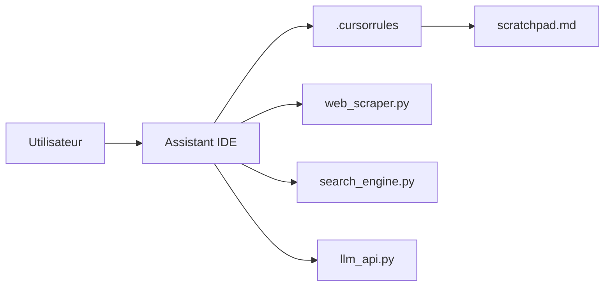

# grapeot/devin.cursorrules

> Rule files and Python scripts to give Cursor or Windsurf a Devin-like agent behavior.

## The problem
An IDE assistant acts with no written plan and no search tools, and forgets the user's corrections from one session to the next.

## What it actually does
Provides `.cursorrules`, `.windsurfrules` or `.github/copilot-instructions.md`, a `scratchpad.md` for plan tracking, and scripts: scraping with Playwright, DuckDuckGo search, LLM analysis, screenshot capture. The experimental mode separates a planner (o1) from an executor (Claude or GPT). The user's corrections are recorded in the rules as "lessons learned".

## How it is wired


## Trying it
```bash
pip install cookiecutter
cookiecutter gh:grapeot/devin.cursorrules --checkout template
```

## Cost and gotchas
API keys (optional according to the README) remain at your expense for the models. Playwright installs its browsers on first use. Last push in May 2025.

## What it is not
Not an autonomous agent: it is a set of instructions that the IDE follows or not. The cost comparison with Devin comes from the README.

## Alternatives
Devin: a commercial agent whose effect this repository aims to reproduce at lower cost.

## For you
Worth watching: a good base for structuring the plan, scratchpad and tools of a coding assistant, but the repository has not evolved since May 2025.
