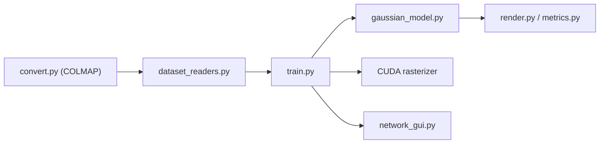

# graphdeco-inria/gaussian-splatting

> Official implementation of 3D Gaussian Splatting for real-time novel view synthesis, for vision researchers.

## The problem
Radiance field methods are expensive to train and render, especially at 1080p on unbounded scenes.

## What it actually does
A PyTorch/CUDA optimizer produces a 3D Gaussian model from photos and SfM data (COLMAP). It also includes a network viewer, a real-time OpenGL viewer (SIBR) and a `convert.py` script. Recent additions: training speed-up, depth regularization, exposure compensation, anti-aliasing. The authors say they have few resources for maintenance.

## How it is wired


## Trying it
```bash
git clone https://github.com/graphdeco-inria/gaussian-splatting --recursive
conda env create --file environment.yml
conda activate gaussian_splatting
python train.py -s <path to COLMAP or NeRF Synthetic dataset>
```

## Cost and gotchas
CUDA GPU (compute capability 7.0+), 24 GB of VRAM for paper-level quality; compatible CUDA SDK 11 and C++ compiler. The full evaluation takes about 7 h on an A6000. A license is present but not identified by GitHub: to be checked (non-commercial use possible).

## What it is not
It is not a turnkey product: support outside Windows 10 and Ubuntu 22.04 is not guaranteed. Scaling to a whole city is not planned.

## Alternatives
No alternative named in the README (Taming-3DGS and Mip Splatting are cited as sources of additions).

## For you
Keep an eye on it: the reference for 3D reconstruction if you have a powerful GPU, but the license needs clarifying and the installation chain is heavy.
