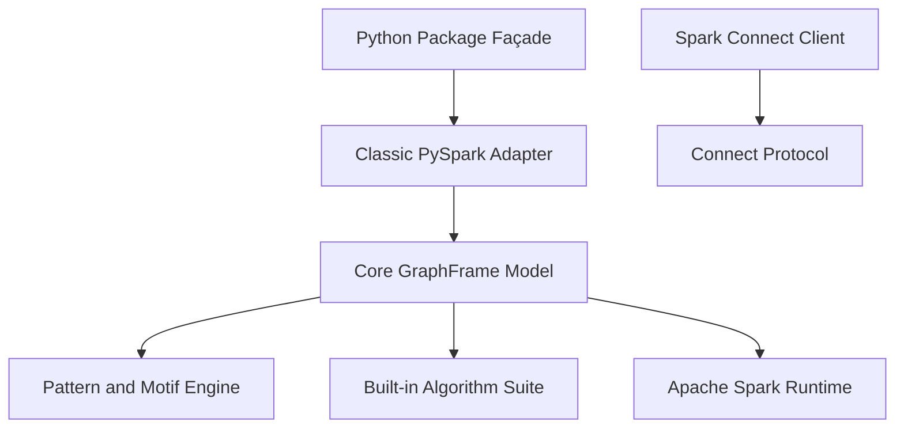

# graphframes/graphframes

> Library of distributed graph algorithms on Apache Spark DataFrames, for data engineers and scientists.

## The problem
Analyzing very large graphs (fraud, identity resolution) exceeds the memory of one machine and of classic tools.

## What it actually does
It adds a GraphFrame abstraction to Spark: distributed algorithms (PageRank, connected components, shortest paths, K-Core, label propagation), motif finding, `Pregel` and `AggregateMessages` APIs, property graphs, random-walk embeddings. It works in Python, Scala and Java, with a Spark Connect mode.

## How it is wired


## Trying it
```bash
python
from graphframes import GraphFrame
g = GraphFrame(nodes_df, edges_df)
g.inDegrees.show()
g2 = g.pageRank(resetProbability=0.15, tol=0.01)
g.connectedComponents().show()
```
The full example first creates a `SparkSession`, then the node and edge DataFrames.

## Cost and gotchas
Free, but a Spark environment is needed. Connected components require a checkpoint directory (`sc.setCheckpointDir`). The choice between classic and Connect mode could not be established.

## What it is not
Not a graph database: the data stays in DataFrames. Not made for small graphs on one machine.

## Alternatives
No alternative named in the README, apart from GraphX, from which it takes a compatibility layer.

## For you
Adopt: for large-scale graph work on Spark (identity, fraud), it is a direct choice, Apache-2.0 and actively maintained.
