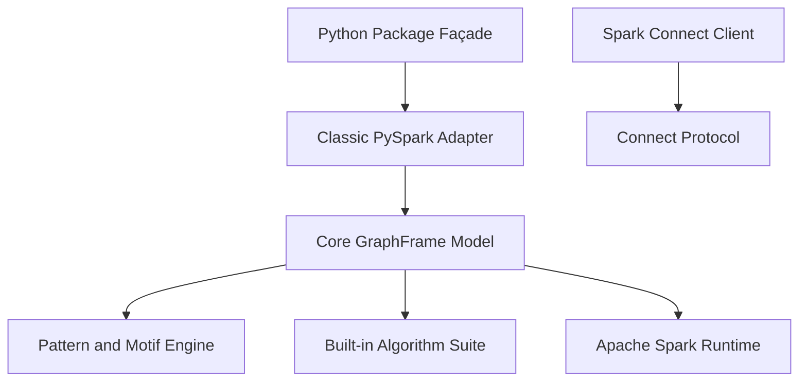

# graphframes/graphframes

> Bibliothèque d'algorithmes de graphes distribués sur Apache Spark DataFrames, pour data engineers et scientists.

## Le problème
Analyser de très grands graphes (fraude, résolution d'identité) dépasse la mémoire d'une machine et des outils classiques.

## Ce que ça fait vraiment
Elle ajoute à Spark une abstraction GraphFrame : algorithmes distribués (PageRank, composantes connexes, plus courts chemins, K-Core, propagation de labels), recherche de motifs, API `Pregel` et `AggregateMessages`, graphes de propriétés, embeddings par marches aléatoires. Elle fonctionne en Python, Scala et Java, avec un mode Spark Connect.

## Comment c'est branché


## Essayer
```bash
python
from graphframes import GraphFrame
g = GraphFrame(nodes_df, edges_df)
g.inDegrees.show()
g2 = g.pageRank(resetProbability=0.15, tol=0.01)
g.connectedComponents().show()
```
L'exemple complet crée d'abord une `SparkSession`, puis les DataFrames de nœuds et d'arêtes.

## Coût et pièges
Gratuit, mais il faut un environnement Spark. Les composantes connexes demandent un répertoire de checkpoint (`sc.setCheckpointDir`). Le choix entre mode classique et Connect n'a pas pu être établi.

## Ce que ce n'est pas
Pas une base de graphes : les données restent dans des DataFrames. Pas fait pour de petits graphes sur une machine.

## Alternatives
Aucune alternative nommée dans le README, hormis GraphX dont il reprend une couche de compatibilité.

## Pour toi
Adopter : pour du graphe à grande échelle sur Spark (identité, fraude), c'est un choix direct, Apache-2.0 et activement maintenu.

