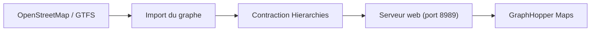

# graphhopper/graphhopper

> Un moteur de calcul d'itinéraires en Java sur OpenStreetMap, pour qui intègre du routage dans une application.

## Le problème
Calculer distance, durée et instructions entre points sur des routes réelles demande un moteur de graphe, ou une API payante.

## Ce que ça fait vraiment
Il charge des données OpenStreetMap (osm ou pbf) et du GTFS, puis calcule itinéraires, alternatives, isochrones, arbres de plus courts chemins et map matching de traces GPX. Les modes speed (Contraction Hierarchies), hybrid et flexible arbitrent vitesse et souplesse. Il tourne en bibliothèque Java ou en serveur web avec interface Maps.

## Comment c'est branché
Schéma simplifié d'après la fiche, sans diagramme fourni.


## Essayer
```bash
wget https://repo1.maven.org/maven2/com/graphhopper/graphhopper-web/11.1/graphhopper-web-11.1.jar \
  https://raw.githubusercontent.com/graphhopper/graphhopper/11.x/config-example.yml \
  http://download.geofabrik.de/europe/germany/berlin-latest.osm.pbf
java -D"dw.graphhopper.datareader.file=berlin-latest.osm.pbf" -jar graphhopper*.jar server config-example.yml
```

## Coût et pièges
Gratuit en auto-hébergement ; il faut une JVM récente (Java 25 ou plus selon le README). La préparation du graphe consomme temps et mémoire ; l'offre commerciale Directions API existe. Le besoin Java n'a pas de valeur dédiée dans les prérequis.

## Ce que ce n'est pas
Pas un service cartographique complet : il faut fournir les données OSM. Le support hors ligne mobile n'est plus officiel.

## Alternatives
- GraphHopper Directions API : offre commerciale du même moteur, sans hébergement à ta charge.

## Pour toi
À surveiller : utile pour des features géospatiales (temps de trajet, isochrones) en data, mais lourd à héberger si le besoin est ponctuel.

