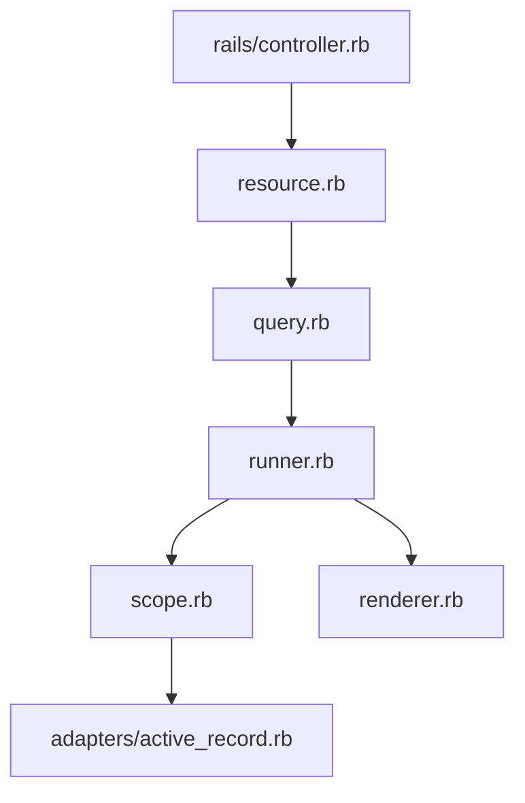

# graphiti-api/graphiti

> Ruby library that exposes ActiveRecord models as a JSON:API through Resources, for Rails developers.

## The problem
Writing controllers and serializers for an API's filtering, sorting, pagination and relationships is repetitive.

## What it actually does
You declare a Resource (attributes, relationships) and Graphiti serves filters, sorting, pagination, sparse fields, statistics and nested reads or writes on a single endpoint. According to the code: the Rails controller calls the Resource, which builds a Query, a Runner executes it, the Scope applies filters via the ActiveRecord adapter, then Renderer and Serializer produce the response.

## How it is wired


## Trying it
```bash
cd website
npm install
npm run start
```
These commands only run the documentation locally.

## Cost and gotchas
Free. You need Ruby and a Rails project (or equivalent); the README gives no command to install the gem.

## What it is not
Not an API client nor a data tool: it is a server-side Ruby API generator.

## Alternatives
No alternative named in the README.

## For you
Ignore: useful for a Rails API, outside the data, AI or MLOps scope.
