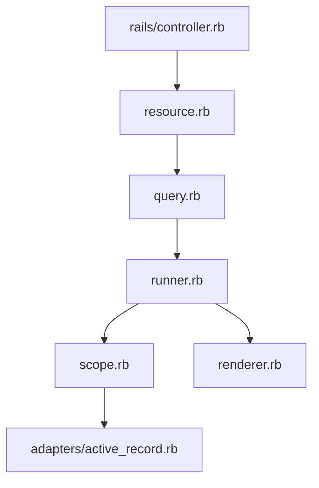

# graphiti-api/graphiti

> Bibliothèque Ruby qui expose des modèles ActiveRecord en API JSON:API via des Resources, pour développeurs Rails.

## Le problème
Écrire contrôleurs et sérialiseurs pour filtrage, tri, pagination et relations d'une API est répétitif.

## Ce que ça fait vraiment
On déclare une Resource (attributs, relations) et Graphiti sert filtres, tri, pagination, champs partiels, statistiques et lectures ou écritures imbriquées sur un seul endpoint. D'après le code : le contrôleur Rails appelle la Resource, qui construit une Query, un Runner exécute, le Scope applique filtres via l'adaptateur ActiveRecord, puis Renderer et Serializer produisent la réponse.

## Comment c'est branché


## Essayer
```bash
cd website
npm install
npm run start
```
Ces commandes lancent seulement la documentation en local.

## Coût et pièges
Gratuit. Il faut Ruby et un projet Rails (ou équivalent) ; le README ne donne pas de commande d'installation de la gem.

## Ce que ce n'est pas
Pas un client d'API ni un outil de données : c'est un générateur d'API côté serveur Ruby.

## Alternatives
Aucune alternative nommée dans le README.

## Pour toi
À ignorer : utile pour une API Rails, hors du périmètre data, IA ou MLOps.

