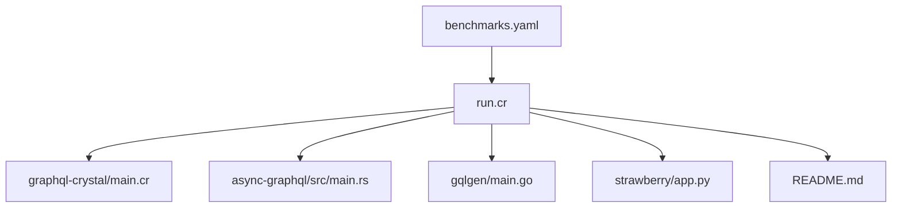

# graphql-crystal/benchmarks

> Comparison of GraphQL servers in many languages on a minimal schema.

## The problem
It is hard to compare the speed of GraphQL libraries in different languages with a common method.

## What it actually does
Each folder contains a server returning "world" for the hello query. The run.cr script reads benchmarks.yaml, loads each server with bombardier and regenerates the README. The table ranks 21 servers; static-rust is in the lead with 110 kps.

## How it is wired


## Trying it
```bash
# Aucune commande documentée dans le README
```

## Cost and gotchas
Free. The test measures a trivial case; the numbers say nothing about a real workload.

## What it is not
Not a selection guide: a "hello world" type query, with no database and no resolvers.

## Alternatives
- No alternative named in the README.

## For you
Ignore: a synthetic benchmark, with no direct relation to your data / AI / MLOps work.
