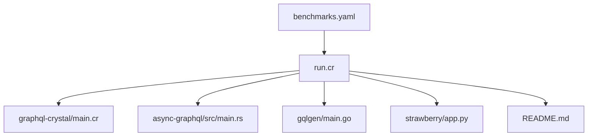

# graphql-crystal/benchmarks

> Comparatif de serveurs GraphQL de nombreux langages sur un schéma minimal.

## Le problème
Difficile de comparer la vitesse de bibliothèques GraphQL dans des langages différents avec une méthode commune.

## Ce que ça fait vraiment
Chaque dossier contient un serveur renvoyant « world » pour la requête hello. Le script run.cr lit benchmarks.yaml, charge chaque serveur avec bombardier et régénère le README. Le tableau classe 21 serveurs ; static-rust est en tête avec 110 kps.

## Comment c'est branché


## Essayer
```bash
# Aucune commande documentée dans le README
```

## Coût et pièges
Gratuit. Le test mesure un cas trivial ; les chiffres ne disent rien d'une vraie charge.

## Ce que ce n'est pas
Pas un guide de choix : une requête de type « hello world », sans base de données ni résolveurs.

## Alternatives
- Aucune alternative nommée dans le README.

## Pour toi
Ignorer : un benchmark synthétique, sans rapport direct avec ton travail data / IA / MLOps.

