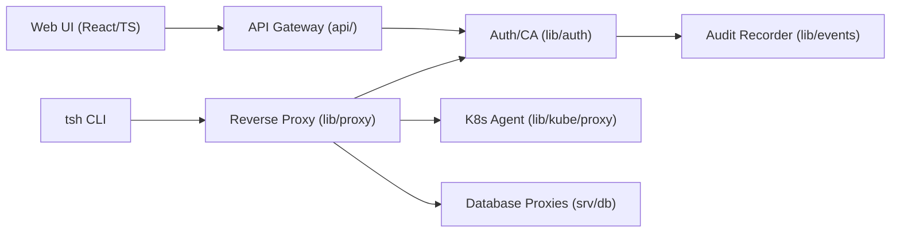

# gravitational/teleport

> Unified access plane: SSO, short-lived certificates and audit for SSH, Kubernetes, databases and MCP.

## The problem
Shared SSH keys, long-lived Kubernetes tokens, bastions and VPNs: access to infrastructure is scattered, poorly audited and hard to revoke.

## What it actually does
A CA issues mTLS and SSH certificates that expire automatically, tied to a human or machine identity.
An identity-aware proxy carries the connections, including behind NAT, without a VPN.
RBAC/ABAC, MFA, just-in-time access requests, session recording for SSH, Kubernetes, databases, RDP.
Also secures MCP connections between clients and agent servers.

## How it is wired


## Trying it
```bash
git clone https://github.com/gravitational/teleport.git
cd teleport
make full
make -C build.assets build-binaries
```

## Cost and gotchas
Self-hostable, but Teleport Enterprise Cloud is paid. Building requires Go, Rust, Node.js, libfido2 and at least 1 GB of virtual memory.

## What it is not
Not an identity provider: it relies on Okta, Entra ID, GitHub. AGPL-3.0. Not a lightweight tool: it is an infrastructure component to operate.

## Alternatives
No named alternative; the README positions itself against VPNs and bastions.

## For you
Worth watching: relevant if you manage a team's access to GPU clusters and databases, especially to supervise agents via MCP; oversized for individual use.
