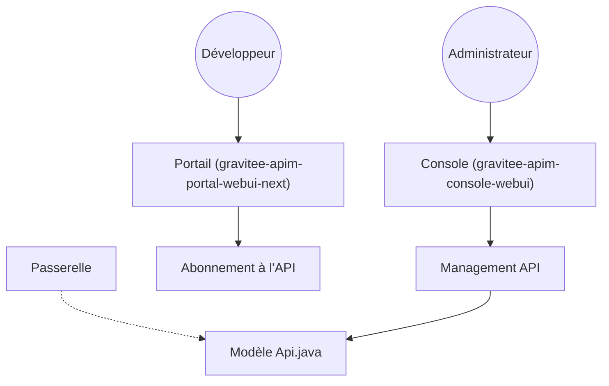

# gravitee-io/gravitee-api-management

> API management platform: gateway, administration console and developer portal.

## The problem
Exposing APIs to internal or external consumers with access control, quotas and a documented catalogue.

## What it actually does
Administration console to register APIs and plans, developer portal (catalogue, subscription), a gateway that serves the APIs, analytics dashboards. More than 50 ready-made policies to shape traffic. An Enterprise licence unlocks additional features.

## How it is wired


## Trying it
```bash
git clone --depth=1 https://github.com/gravitee-io/gravitee-api-management
cd gravitee-api-management/docker
make mongodb
# ou : cd quick-setup/mongodb && docker compose down -v && docker compose pull && docker compose up -d
```

## Cost and gotchas
Docker and MongoDB. Default credentials `admin` / `admin` must be changed. Some features require the Enterprise licence (`LICENSE_KEY` variable).

## What it is not
Not an API tool for ML models as such: it is a generic API governance layer. Many server/gateway relationships are not established in the provided diagram.

## Alternatives
No alternative named in the README.

## For you
Watch: useful if you have to publish and control access to model APIs, but heavy to operate for a single use.
