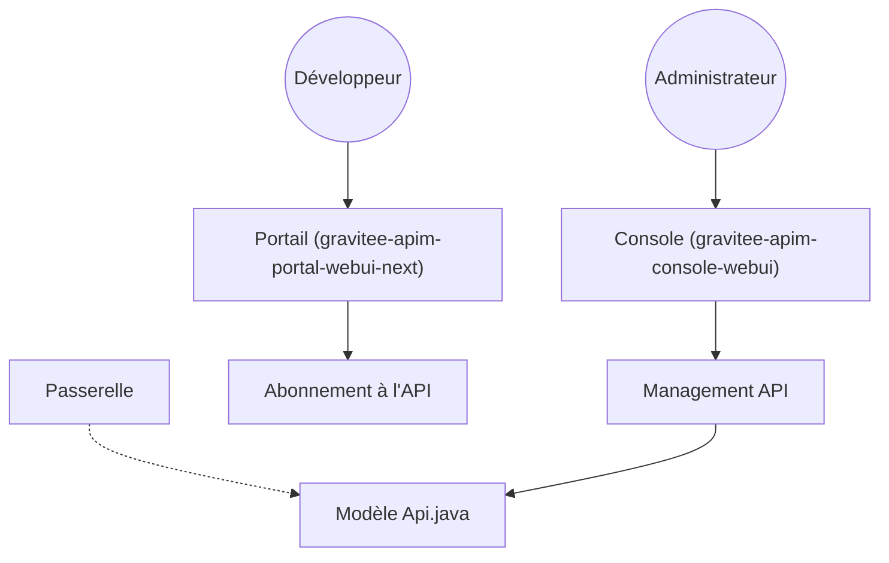

# gravitee-io/gravitee-api-management

> Plateforme de gestion d'API : passerelle, console d'administration et portail développeur.

## Le problème
Exposer des API à des consommateurs internes ou externes avec contrôle d'accès, quotas et catalogue documenté.

## Ce que ça fait vraiment
Console d'administration pour enregistrer les API et les plans, portail développeur (catalogue, abonnement), passerelle qui sert les API, tableaux de bord d'analytique. Plus de 50 politiques prêtes à l'emploi pour façonner le trafic. Une licence Enterprise active des fonctions supplémentaires.

## Comment c'est branché


## Essayer
```bash
git clone --depth=1 https://github.com/gravitee-io/gravitee-api-management
cd gravitee-api-management/docker
make mongodb
# ou : cd quick-setup/mongodb && docker compose down -v && docker compose pull && docker compose up -d
```

## Coût et pièges
Docker et MongoDB. Identifiants par défaut `admin` / `admin` à changer. Une partie des fonctions exige la licence Enterprise (variable `LICENSE_KEY`).

## Ce que ce n'est pas
Pas un outil d'API pour modèles ML en soi : c'est une couche de gouvernance d'API générique. Beaucoup de relations serveur/passerelle ne sont pas établies dans le diagramme fourni.

## Alternatives
Aucune alternative nommée dans le README.

## Pour toi
Surveiller : utile si tu dois publier et contrôler l'accès à des API de modèles, mais lourd à opérer pour un seul usage.

