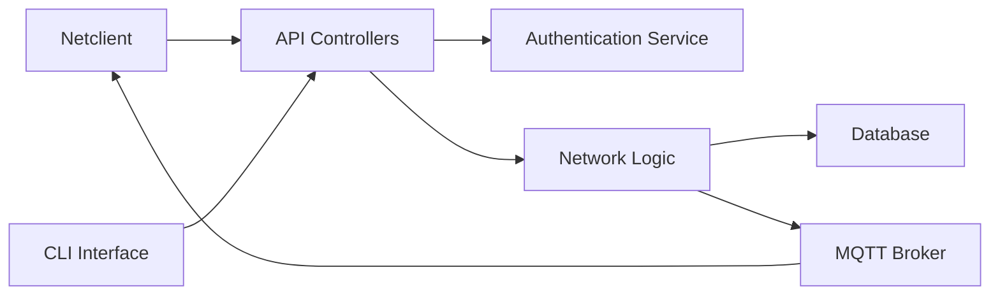

# gravitl/netmaker

> Self-hosted or SaaS automation of WireGuard networks (mesh, site-to-site, remote access).

## The problem
Linking datacenters, clouds and edge machines with WireGuard by hand becomes unmanageable beyond a few nodes.

## What it actually does
Server that creates and manages WireGuard networks, remote access gateways, mesh VPNs and site-to-site links.
Admin UI, OAuth, private DNS, access control lists.
`netclient` client on Linux, Docker, Mac, Windows; MQTT broker to push configuration.
Self-hosted Pro version and netmaker.io SaaS.

## How it is wired


## Trying it
```bash
sudo wget -qO /root/nm-quick.sh https://raw.githubusercontent.com/gravitl/netmaker/master/scripts/nm-quick.sh && sudo chmod +x /root/nm-quick.sh && sudo /root/nm-quick.sh
```

## Cost and gotchas
Requires an Ubuntu 24.04 VM with a fixed public IP, ports 443 and 51821 open, wildcard DNS recommended.
License not identified by GitHub; high-availability features are in Pro.

## What it is not
Not WireGuard itself: it is a management layer.
Not a data or ML tool.

## Alternatives
No alternative named in the README.

## For you
Ignore for your profile: useful for network infrastructure, with no direct link to data; and the license needs checking.
